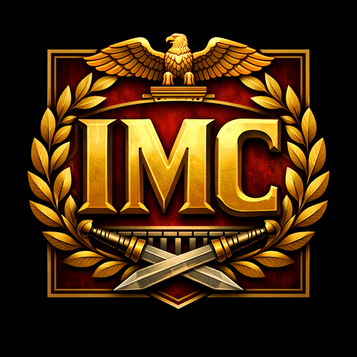
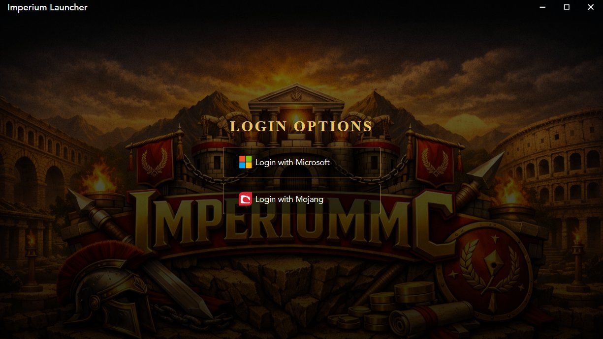

<p align="center"></p>

<h1 align="center">Imperium Launcher</h1>

<p align="center">The official launcher for <a href="https://imperium-mc.net">ImperiumMC</a> (<code>play.imperium-mc.net</code>).<br>It keeps Imperium Client and the server's pack in sync and starts Minecraft with your real Microsoft session.</p>



Imperium Launcher is a fork of [Helios Launcher](https://github.com/dscalzi/HeliosLauncher) by Daniel Scalzi, released under the MIT licence. Almost everything here is Helios' work; this fork changes the branding, theme and distribution index. See [Credits and licence](#credits-and-licence).

## Status

Milestone 1 of the launcher plan (fork, rebrand, Windows installer) is done. Not working yet:

| Area | State |
| ---- | ----- |
| Distribution index | Placeholder at [`distribution/distribution.json`](distribution/distribution.json) with no modules, so **Play does not work yet**. See [docs/distribution-index.md](docs/distribution-index.md). |
| Microsoft login | Uses a placeholder Azure client ID until the steps below are done. The sign-in window opens and Microsoft rejects it. |
| macOS / Linux installers | Config is inherited from Helios but untested. |

## Microsoft login

Helios' Microsoft login is used unchanged. Imperium needs its own Azure app registration, and Mojang must approve that app before it can call the Minecraft services API. Forks can't reuse another launcher's client ID. Approval can take weeks, so start early.

### 1. Register the Azure app

1. Sign in at <https://portal.azure.com> and open **Microsoft Entra ID** → **App registrations** → **New registration**.
2. **Name:** `Imperium Launcher`.
3. **Supported account types:** *Accounts in any organizational directory (Any Microsoft Entra ID tenant - Multitenant) and personal Microsoft accounts (e.g. Skype, Xbox)*. Personal accounts are required, because almost every Minecraft account is one.
4. Leave **Redirect URI** blank and click **Register**.
5. Open **Authentication** → **Add a platform** → **Mobile and desktop applications**, and add this redirect URI:
   `https://login.microsoftonline.com/common/oauth2/nativeclient`
   The launcher's sign-in window ([`index.js`](index.js)) watches for that redirect to collect the auth code.
6. Open **Certificates & secrets** → **New client secret**, then add one. The launcher never uses it, but Microsoft's review expects the app to have one. Don't commit it.
7. On **Overview**, copy the **Application (client) ID** and the **Directory (tenant) ID**.

### 2. Put the client ID in the launcher

Set `AZURE_CLIENT_ID` in [`app/assets/js/ipcconstants.js`](app/assets/js/ipcconstants.js). The client ID is public (it ships in every installer), so it can live in git.

### 3. Get Mojang approval

1. Build the launcher and **try to sign in at least once** with the new client ID. It fails with an error, but Microsoft needs to see activity on the app before it will review it.
2. Submit the app at <https://aka.ms/mce-reviewappid> with the client ID and tenant ID. Describe it as the official launcher for ImperiumMC that signs players in to launch Minecraft: Java Edition.
3. Wait for the approval email. After approval it can take up to 24 hours before the Minecraft services API accepts tokens from the app.

Until approval, sign-in fails at the Minecraft services step (`api.minecraftservices.com/authentication/login_with_xbox` returns 403).

More detail: Helios' own guide in [docs/MicrosoftAuth.md](docs/MicrosoftAuth.md), and Minecraft's [help article on launcher app registration](https://help.minecraft.net/hc/en-us/articles/16254801392141).

## Development

Requires [Node.js](https://nodejs.org/) 22 (`engines` in `package.json`). Node 24 also builds.

```console
git clone https://github.com/MylesThePro1/ImperiumLauncher.git
cd ImperiumLauncher
npm ci
npm start
```

npm 11 skips dependency install scripts that aren't on its allow list, which leaves `node_modules/electron/dist` empty. If `npm start` says Electron failed to install, run `node node_modules/electron/install.js`, or extract the cached `electron-v<version>-win32-x64.zip` from `%LOCALAPPDATA%\electron\Cache` into `node_modules/electron/dist` and write `electron.exe` to `node_modules/electron/path.txt`.

### Build installers

```console
npm run dist
```

| Platform | Command | Output |
| -------- | ------- | ------ |
| Windows x64 | `npm run dist:win` | `dist/Imperium-Launcher-setup-VERSION.exe` |
| macOS | `npm run dist:mac` | `dist/Imperium-Launcher-setup-VERSION-{x64,arm64}.dmg` |
| Linux x64 | `npm run dist:linux` | `dist/Imperium-Launcher-setup-VERSION.AppImage` |

Installers aren't code-signed yet, so Windows SmartScreen warns on first run.

On Windows without Developer Mode, electron-builder fails while extracting `winCodeSign-2.6.0.7z` ("Cannot create symbolic link"). The failing links are macOS-only files. Extract the archive once with errors ignored into `%LOCALAPPDATA%\electron-builder\Cache\winCodeSign\winCodeSign-2.6.0`, and later builds reuse it.

### Console

`Ctrl+Shift+I` opens DevTools. Don't paste anything into it unless you know what it does.

### Where things live

| What | Where |
| ---- | ----- |
| Distribution index URL | `REMOTE_DISTRO_URL` in [`app/assets/js/distromanager.js`](app/assets/js/distromanager.js) |
| Azure client ID | `AZURE_CLIENT_ID` in [`app/assets/js/ipcconstants.js`](app/assets/js/ipcconstants.js) |
| UI strings, links, welcome text | [`app/assets/lang/_custom.toml`](app/assets/lang/_custom.toml) and `en_US.toml` |
| Theme | [`app/assets/css/launcher.css`](app/assets/css/launcher.css) (gold `#d4a54f` / `#e8c563` / `#b8923d`, matching imperium-mc.net) |
| Icons and backgrounds | `app/assets/images/`, `build/icon.png`, `build/icon.ico` |
| Launcher data on the player's PC | `%APPDATA%\.imperiumlauncher` (Windows) |
| Auto-update source | GitHub Releases of this repo (`electron-builder` publish config + `dev-app-update.yml`) |

## Credits and licence

Imperium Launcher is based on [Helios Launcher](https://github.com/dscalzi/HeliosLauncher), Copyright (c) 2017-2026 Daniel D. Scalzi, used under the MIT licence. The full licence text is in [LICENSE.txt](LICENSE.txt) and must stay with every copy. The Helios source is tracked as the `upstream` remote so fixes can be merged in.

Helios is supported by its own projects: [Nebula](https://github.com/dscalzi/Nebula) generates distribution indexes, and [helios-core](https://github.com/dscalzi/helios-core) handles downloads, Java management and auth.

ImperiumMC names, logos and artwork are not covered by the MIT licence and belong to ImperiumMC.

Imperium Launcher is not an official Minecraft product and is not approved by or associated with Mojang or Microsoft.
